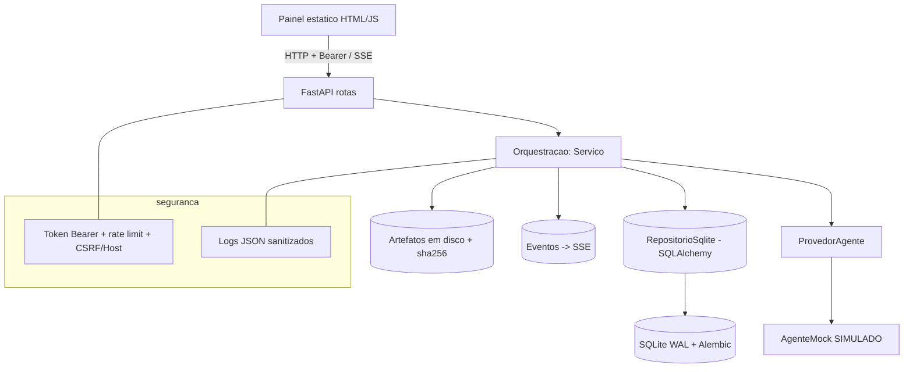
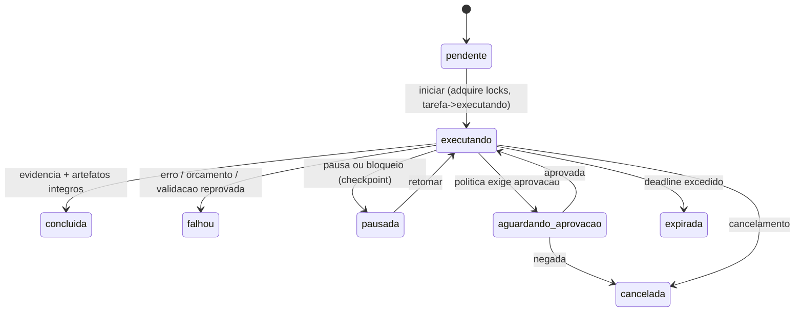

# Design — Forja Fundacao (Fase 1)

## Camadas (separacao estrita, secao 1.2.10)

- `forja/servidor` so traduz HTTP; nenhuma regra de negocio nem SQL.
- `forja/orquestracao/servico.py` concentra casos de uso e a maquina de estados; nao abre conexoes HTTP.
- `forja/adapters/sqlite` isola persistencia; `ProvedorAgente` isola execucao (mock hoje, Kiro ACP na Fase 2).
- Contratos em `forja/dominio/contratos.py` (Pydantic v2) nao contem tipos do Kiro.

## Concorrencia

- Dois engines SQLite: escrita com `BEGIN IMMEDIATE` (escritores serializados, sem deadlock por upgrade),
  leitura com `BEGIN`. WAL permite leituras concorrentes.
- Transicao de tarefa usa UPDATE condicional (`estado` + `versao_estado`): resiste a corridas e a reconexao do browser.
- Execucao roda em `ThreadPoolExecutor`; o `ControleExecucao` oferece cancelamento/pausa cooperativos e checkpoint.

## Ciclo de vida de execucao

## Verificacao de conclusao (anti-mock-como-feature)

Uma tarefa so chega a `concluida` quando: estado passa por `validando`; existe >=1 evidencia; e o hash SHA-256
de cada artefato gravado confere. Evidencias de mock levam `simulada=true` e sao contabilizadas como tais.

## Seguranca (secao 15)

- Bind loopback; token Bearer obrigatorio; token gerado em `data/api_token.txt` (ignorado no Git) se nao houver
  `APP_API_TOKEN`. Validacao de Host e de Origin (CSRF). Rate limit por janela fixa. Logs redigem segredos.
- Padroes de recurso de tarefa sao validados contra path traversal/absoluto/drive antes de persistir.

## Decisoes abertas
Ver ADRs em `docs/adr/`. Pendencias materiais listadas em `docs/STATUS_IMPLEMENTACAO.md`.
